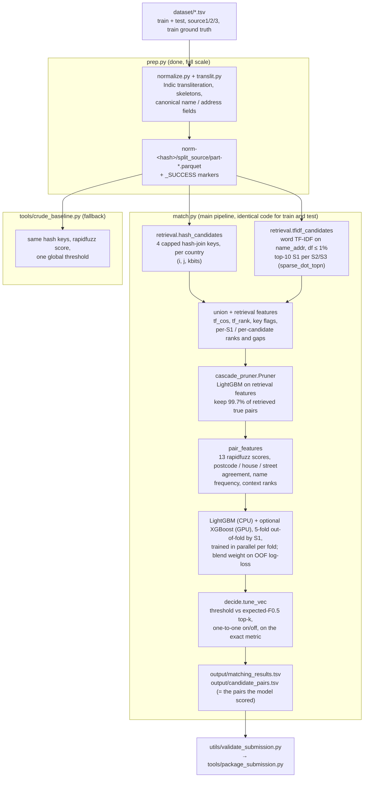

# Architecture: Amazon ML Challenge 2026 — Business Entity Resolution

*Verified against the working tree on 2026-09-27 (deadline day). Updated in the same session every time
the code changes; see the changelog at the bottom.*

---

## 1. What this system does

Given three noisy business-record sources (S1 = deduplicated reference, S2/S3 = records to attach to it),
output, for every test S1 record, the S2/S3 records describing the same business. Score: macro `F0.5` per S1
record (precision weighted over recall; a correct empty prediction for a singleton scores 1.0).

As of this session the repo is a single-team codebase with **one main pipeline**, `src/match.py`. Everything
else is either the shared normalisation stage, a fallback, or legacy code.

| Pipeline | Entry point | Status |
|---|---|---|
| **Main: `match.py`** | `src/match.py` | Full scale, polars, reads the `prep.py` parquet cache. Retrieval (hash keys + configurable TF-IDF views, `EXTRA_VIEWS`) → cascade pruner → 94 pair features (`f5`) → LightGBM + optional GPU XGBoost out-of-fold → vectorised expected-F0.5 decision rule → both TSVs. `--tfidf-k 0` reproduces the hash-keys-only "step 1" run. |
| Fallback: crude baseline | `tools/crude_baseline.py` | No-ML hash-join + one global threshold. Valid, full scale, test-mix ≈ 0.823. Kept as the safety net. |
| Legacy: `run.py` | `src/run.py` → `blocking.py` → `features.py` → `model.py` | Pandas, in-memory, never run above a 1% sample. Superseded by `match.py`; `decide.py`/`metric.py` are shared. |

---

## 2. Tech stack

| Layer | Choice | Notes |
|---|---|---|
| Language | Python 3.11 (dev box ran 3.12) | |
| I/O, joins, group-by features | **polars** 1.44.2 | Every full-scale stage. All TSV columns read as strings, no quote handling |
| Numerics | numpy 2.4.4, scipy 1.17.1 | Sparse matrices, vectorised decision rules |
| TF-IDF | scikit-learn 1.8.0 `TfidfVectorizer` | Word view on `name_addr`, per country, df-capped |
| Exact sparse top-k | **sparse_dot_topn 1.2.0** (Apache-2.0) | Multi-threaded `sp_matmul_topn`, S2/S3 → S1 |
| ANN (experimental, not in main pipeline) | faiss-cpu 1.15.1 (MIT) | `retrieval.countrywise_ann_pairs` / `ann_candidates` |
| String similarity | rapidfuzz 3.14.6 | 13 scorers via `process.cpdist` (vectorised, all cores) |
| Models | LightGBM 4.7.0 (MIT); XGBoost 3.4.1 (Apache-2.0, optional) | Cascade pruner + matcher. `--models lgb,xgb --device cuda` trains XGBoost on the RTX 4080 alongside LightGBM on CPU and blends them. The CPU is the default. No pretrained weights. |
| Storage | Parquet (zstd) | Normalisation cache and per-split feature cache, both code-hashed |
| Parallelism | `ProcessPoolExecutor` with **spawn** (prep); library threads elsewhere | spawn avoids the polars fork deadlock on Linux |

All dependencies are pinned in `code/business_entity_resolution/requirements.txt` (sparse_dot_topn and
faiss-cpu added this session). Everything is MIT/BSD/Apache and CPU-only.

---

## 3. Flowchart

---

## 4. Modules

### Normalisation (unchanged this session)
- **`translit.py`** — one ISCII-offset table for nine Brahmic scripts; `skeleton()` consonant classes so English
  and transliterated spellings collide.
- **`normalize.py`** — symmetric canonical dictionaries, country-agnostic; ~19 derived fields per record.
- **`prep.py`** — parallel normalisation into `norm-<sha1(normalize.py, translit.py, v2)>/`. Built at full scale in
  `cache/real_prep/norm-c401d63ff2/`, and its hash matches the current code.

### Retrieval: `retrieval.py`
- `hash_candidates(s1, cand)` — polars port of the crude baseline's four keys (exact name; skeleton + one of the two
  rarest address words; house number + street word; first skeleton token + house number), each scoped by
  country, groups capped at ≤5 S1 / ≤50 candidates. Returns `(i, j, kbits)`, where `kbits` records which key(s) fired.
- `tfidf_candidates(s1, cand, col, k, max_df, analyzer, ngram_range, extra=...)` — per country: TF-IDF on `col`
  (tokens in more than `max_df` of records or seen only once are dropped), then exact top-k S1 for every S2/S3
  record through `sparse_dot_topn`. `analyzer`/`ngram_range` select word tokens or `char_wb` n-grams (typo/spelling
  tolerant). Passing a prior call's `(i, j)` as `extra` scores those pairs too and gives every pair both views'
  scores — chaining calls this way unions any number of views into one candidate set.
- **`EXTRA_VIEWS` (in `match.py`, generalises what used to be one hardcoded char view):** `char` (name_core,
  char 3–4-grams), `addr` (addr_clean, word), `ns` (name_nospace, char 3–4-grams). Each is on/off and independently
  sized via `--char-k`/`--addr-k`/`--ns-char-k` (and matching `--*-max-df` flags); `candidates()` loops over
  whichever are configured and chains them onto the hash+word union via `extra`. `cascade_pruner.py` and the
  `RETRIEVAL_COLS` feature list read whichever per-view columns are actually present, so views can be added or
  dropped from a run without touching either file.
- `tfidf_pair_cosine(s1, cand, pairs, col, ...)` — TF-IDF cosine for a *given* set of pairs (no top-k search); used
  both as a pair feature and for post-hoc diagnostics (e.g. scoring a pair retrieval never found).
- Experimental, unused by `match.py`: `exact_key_candidates` (pandas, contract schema), `ann_hnsw_search`,
  `bidirectional_ann_pairs`, `countrywise_ann_pairs`, `ann_candidates`, `union_candidates`.

### Cascade pruner: `cascade_pruner.py`
LightGBM (63 leaves, 300 rounds) on 14 retrieval-time features: TF-IDF cosine and rank, key flags and count,
per-candidate best cosine and gap, per-S1 rank and gap, and pairs per S1 / per candidate. It trains on 20% of train
S1 and picks the threshold on a disjoint 10% so that 99.7% of retrieved true pairs survive. The model and threshold
are saved next to the feature cache, and test reuses them. The fit logs the kept share at 99.9/99.8/99.5/99% for tuning.

### Matcher: `match.py`
- **Features (93 at f4/v3; +1 at f5): `FEATURE_VERSION` bumps whenever a definition changes** (`f2`→`f4`→`f5`,
  it names the feature cache so a bump forces a rebuild, nothing else does). 13 rapidfuzz scores on name core,
  skeleton, no-space name, address, landmark-free address and address words; postcode, house and street
  agree/conflict; lengths; empty flags; Indic flags; `is_s3`; name frequency per country (a chain signal); the
  crude score `base`; rank and gap-to-best of `base`/`n_tset`/`a_tset`/`n_skel_tset` within the S1 and within the
  candidate; candidate counts; and the carried retrieval features (per configured view) plus the pruner's probability.
  - **f3** added: landmark flags; overlap, Jaccard and conflict over *all* address numbers and over numbers in the
    name; field swap (name vs the other record's address); per-country TF-IDF cosines for name words, address
    words and name character 3-grams (`retrieval.tfidf_pair_cosine`); context over the name cosine.
  - **f4** added: data-driven per-country **source-noise tokens** (`source_noise_tokens`/`_denoised`) — tokens one
    source uses far more than another (e.g. French "Participations"/"Holding", Indian unmapped transliterations),
    detected unsupervised from the provided records, with similarity features recomputed on the de-noised text.
    This is the largest single validated gain so far: LOCO mean 0.9110 → 0.9227, and +0.011 real LB (v2→v3, part
    of a 0.9365→0.947 jump that also included other f4/f3 features).
  - **f5** added: legal-form-conflict — extracted legal suffixes (Ltd/LLP/Pvt/GmbH/SARL/...) compared between the
    two records (`name_legal`, via `_set_overlap`). Found missing during a false-positive audit; suffix conflicts
    are a strong precision signal (~50× more common among false positives than true matches in that audit).

  Nothing reads the country label directly.
- **Training:** 5 folds grouped by S1 over **all** train pairs, so the one-to-one competition between S1s is intact.
  Each fold's model trains on a 30% sample of the other folds' S1 records (10% of that held out for early stopping).
  The final model uses the same sampling over all folds.
- **Decision:** `decide.tune_vec` tries a global threshold and the expected-F0.5 top-k rule, each with and without
  one-to-one, scored with the exact per-S1 F0.5 (all true matches counted, including ones retrieval never found),
  and picks the best test-mix score (`0.47·India + 0.38·US`, renormalised).
- **Outputs:** `matching_results.tsv`, `candidate_pairs.tsv` (every pair the model scored), and `debug/`:
  `metrics_train.json`, `decision_rules.csv`, `importance.tsv`, `model.txt`, `test_probs.parquet`.
- **Caching:** candidate pairs and the pruner go to `<work>/pairs-<key>/`; features go to `<work>/feat-<key>/`.
  The key is **not** a source hash — it's `RETRIEVAL_VERSION` (`retrieval.py`) / `PRUNER_VERSION` (`cascade_pruner.py`)
  / `FEATURE_VERSION` (`match.py`) plus the config values that affect output (k, max_df per view, prune-recall).
  These are hand-bumped when a change actually alters what's returned; a source-hash scheme was tried first but was
  found to silently invalidate a cache from *any* edit to a relevant file — including a backward-compatible signature
  change (new optional param, existing call sites unaffected) — which once cost a ~45-minute unplanned retrieval
  rebuild mid-run. Both caches are reused automatically; `--no-cache` recomputes. A feature-only change now costs
  minutes, not a 40-min retrieval rerun.
- **Models:** `fit_model(kind, device, …)` wraps LightGBM and XGBoost behind one interface. With two kinds, each fold
  trains both in parallel threads, so a fold costs the slower of the two (LightGBM ~190 s; XGBoost on GPU ~57 s).
  The blend weight is chosen on OOF log-loss, and the decision rule is tuned once on the blend.
  Each model's score alone, under the same rule, is logged for comparison.

### Second stage: `stage2.py` (wired into `match.py` behind `--stage2`)
Context over the stage-1 probability *p*:
- **Within the S1:** rank, best, gap to best, runner-up, total mass, pairs above 0.5, and this pair's share of the mass.
- **Within the candidate:** the best competing S1, and the margin over the best *other* S1.
- **Sibling agreement:** compared with the S1's other top-3 candidates: name and address similarity (max, mean,
  p-weighted mean), and house-number and postcode agreement and conflict.

On train it uses out-of-fold *p*, to avoid leakage; on test it uses the final stage-1 model's *p*.
Stage 2 trains with the **same folds** as stage 1 (same seed). It is kept only if its out-of-fold score beats stage 1;
otherwise the stage-1 model and rule are used. Its models are saved to `debug/stage2/`.
Tested end to end on synthetic data: both the "keep stage 1" branch and a forced "use stage 2" branch; output PASSes the validator.

**Measured on real f4 features (XGBoost only, GPU, matching v3's cache): group-CV +0.0096 mix — a real,
sizeable in-distribution gain. But leave-one-country-out on the same features: −0.0011 — it does *not* transfer
to a country never trained on.** Group-CV mixes random folds of countries the model has already seen, so it can
reward a model for learning country-relational calibration (e.g. "this probability distribution shape means
India") that has no counterpart in an unseen country like France. This is why a France-relevant change is judged
on the LOCO number, never group-CV alone — see `decide.tune_robust` below. Stage 2 has not shipped in any upload
for this reason; it needs either a fix that makes its signal country-agnostic or explicit sign-off to ship anyway.

### France proxy: `--cv country`
Leave-one-country-out. Train on US and score India, then the reverse, with no test outputs.
- Reported under the **shipped** rule (expected-F0.5, α = 1, one-to-one), which is how France is actually decided: by a rule tuned on other countries.
- Also reported under a rule re-tuned on the held-out predictions, as an optimistic upper bound.
- Written to `debug/metrics_loco.json`.

**Use:** compare feature sets on transfer to an unseen country before spending an upload.

### Decision and metric: `decide.py`, `metric.py`
The dict-based rules are still there for the legacy `run.py`. The new vectorised versions (`per_s1_f05`, `o2o_mask`,
`expf_mask`, `rule_mask`, `tune_vec`) were checked against them on random data: zero mismatches, identical metric.

`decide.tune_robust(table_groupcv, table_loco, france_weight=0.15)` picks **one** rule for every test record —
never a per-country branch, which the competition rules forbid — by blending each candidate rule's group-CV mix
score with its LOCO mean: `robust_score = 0.85 × mix + 0.15 × loco_mean`. This exists so a feature/rule that looks
best in-distribution but is a bad bet on an unseen country (see stage 2, above) can be caught before an upload,
without ever conditioning the shipped rule on the country label itself. Tested on real v3 OOF data: in that case
the robust choice matched the group-CV-only choice (expF, α=1, o2o=True) — confirming it's a safe drop-in
replacement for `tune_vec` that costs nothing when the two agree.

### Tools (not shipped)
`crude_baseline.py` (fallback), `bench_retrieval.py` / `bench_union.py` (retrieval benchmarks), `profile_*.py`,
and `package_submission.py` (zip builder: point `--output-dir` at the chosen `output_*/`).

---

## 5. Results (full scale, train out-of-fold; test-mix = India/US reweighted to the test mix)

| Run | Candidate recall | Ceiling (perfect matcher) | India | US | Test-mix | Runtime |
|---|---|---|---|---|---|---|
| Crude baseline (`output_crude/`) | 0.808 | 0.904 | 0.800 | 0.852 | 0.823 | 6 min |
| Step 1: `match.py --tfidf-k 0` (`output_v1/`) | 0.808 | 0.904 | 0.833 | 0.929 | **0.876** | 21 min |
| Step 2: `match.py --tfidf-k 10` (`output_v2/`) | 0.968 → 0.965 after pruning | 0.985 | 0.936 | 0.966 | **0.949** | train ≈ 51 min; test outputs being written |

Step 2, train side, full scale:
- **Retrieval:** TF-IDF top-10 took 6 min for India (883k S1 × 4.1M candidates) and 12 min for US (1.32M × 6.2M) on 28 cores. The union with hash keys has 110.1M pairs (49.9 per S1) and finds 0.968 of all true matches.
- **Pruner:** 6.5× cut to 17.0M pairs (7.7 per S1) at 99.7% of retrieved true pairs, for final recall 0.965. The held-out tradeoff: keeping 99.9% keeps 20.3% of pairs, 99.8% → 17.2%, 99.5% → 13.5%, 99% → 11.3%.
- **Model:** 5 folds at 165–287 s each (best iteration 1.6k–2.3k), then the final model. Training is now the longest stage (~23 min).
- **Decision:** expected-F0.5 with one-to-one, α = 1.0. The best plain threshold (p ≥ 0.65 with one-to-one) is only 0.0006 behind.
- **Where the gain came from:** recall. India rose 0.10 (0.833 → 0.936) and US 0.04. About 0.036 remains between the model and the ceiling; that gap is now the matcher's to close.

---

## 6. Bottlenecks and suggestions

| ID | Bottleneck | Status / suggestion |
|---|---|---|
| B1 | No current valid submission | **Done.** `output_crude/` and `output_v1/` both pass the official validator. |
| B2 | Retrieval and pruner not wired to anything | **Done.** `match.py` runs retrieval → pruner → features → model → decision. |
| B3 | faiss / sparse_dot_topn not pinned | **Done.** Both pinned in `requirements.txt`. |
| B4 | Legacy `run.py` unproven at scale | **Superseded** by `match.py` (full-scale, polars). Keep `run.py` out of the submission or document it as legacy. |
| B5 | Candidate recall caps F0.5 | **Largely addressed.** Hash keys alone: 0.808 recall, 0.904 ceiling. With TF-IDF top-10 + pruner: 0.965 recall, 0.985 ceiling. Next: analyse the remaining 3.2% of misses, and add a char n-gram or name-only view if they're mostly typos or Indic spellings. |
| B6 | TF-IDF retrieval is slow: 19 min on train, 28 cores (India 6 + US 12) | Cost grows roughly quadratically with country size. Options: lower `max_df` (0.005), or a GPU sparse top-k (torch/CUDA; high engineering risk). |
| B7 | Memory: 110M pairs before pruning; features + model matrix ≈ 2× the pruned frame | The pruner keeps it bounded (17M pairs); `--prune-recall` trades recall for memory. Peak RAM ≈ 9–10 GB. |
| B12 | **Reproduction runtime on the organisers' 16 CPUs (3 h limit).** The full step-2 run is ≈ 1.5 h on 28 cores, of which ~23 min is 5-fold out-of-fold training that exists only to choose the decision rule. | Add a reproduction mode that trains the final model once and reuses the saved rule. Time a run capped at 16 threads before the final package. |
| B13 | Feature cache and retrieval were coupled | **Done.** Separate `pairs-`/`feat-` caches. Originally keyed on function source; rekeyed to hand-bumped version constants (see Matcher §Caching, above) after a source-hash false-invalidation cost an unplanned ~45-min retrieval rebuild mid-run. The v2 cache was migrated across both scheme changes, so no retrieval rerun was needed. |
| B14 | Idle GPU | **Done.** XGBoost with CUDA (`--models lgb,xgb --device cuda`): a fold takes 57 s on GPU vs 187 s for LightGBM on CPU, at almost the same log-loss (0.0696 vs 0.0692). **Decision rule for shipping:** XGBoost ships only if the blend beats LightGBM alone by ≥ 0.002 OOF *and* the CPU-only reproduction run fits comfortably inside 3 h on 16 threads. |
| B8 | France is unlabelled; decisions are tuned on India/US only | **Measured and partly addressed.** Upload #1 (v2) scored 0.9365 public, which implies **France ≈ 0.86–0.89** vs ~0.94–0.97 for India/US. `tools/spot_check.py` findings:  • The model is *confident* on France (4.3% of pairs uncertain vs 6–7%), so the errors are confident mistakes.  • House-number conflicts are **not** France-specific (train true matches also conflict: India 22%, US 13%).  • **The main cause:** S2/S3 pad French names with words S1 never uses ("Participations", "Holding", "Distribution", "Développement", "Associés", "Groupe", 2–4% each). US has the same effect far more weakly ("Midtown", "Riverside"), and India has unmapped transliterations ("limitet", "venchars").  • **Fix, f4:** data-driven source-noise tokens (same rule for every country, no labels) and similarity features on the de-noised text.  • **Still open:** the France proxy run (train on one country, score the other). |
| B15 | Normalisation gaps surfaced by the spot-check | **Done**, in `normalize.py`: `cours`→`cross` (was `crs`, which collided with the existing `crs`→`cross` entry so "Cours X" and "Crs X" never matched — single-pass dict lookup); `N°` (`_NDEG_RE`) stripped before `basic_clean`, which was leaving a stray `n` confusable with north→`n`; `q`→`quai`; `appartement`→`apt`; state codes `tg`/`dl` and native spellings `tamizhnatu`/`keralam`/`pashchimabang` added to `PHRASES`. Verified with concrete before/after test cases. India transliteration snapping (`limitet`, `infrastrakchar`, etc.) is still open — f4's de-noising covers it at feature level without needing exact dictionary entries. |
| B9 | No automated tests | The vectorised decision rules have a parity check against the originals (run ad hoc this session). A small `tests/` with that check and normalisation examples would catch regressions cheaply. |
| B10 | Stale code paths (`exact_key_candidates`, the ANN functions, `run.py`, `blocking.py`, `features.py`, `model.py`) | They ship in the zip as-is. Either delete them before packaging or keep them clearly marked experimental/legacy (this document does). |
| B11 | Orphaned `output/pairs/candidate_pairs.parquet` (19,838 rows, old contract) | Delete, since nothing reads it. |
| B16 | Retrieval union still misses ~3.2–3.5% of true pairs (detailed miss analysis: 68% high-char-similarity/word-tokenisation failures, 42% empty-address dilution, India 72% of misses vs 40% of candidate share) | Generalised retrieval to `EXTRA_VIEWS` (char n-gram, address word, name-no-space char n-gram — see Retrieval §, above), each independently configurable. char view alone validated in a smaller run; the full char+addr+ns config is `output_v5` (in progress). Also: a cheap diagnostic on the current miss set found 50.4% of missed true pairs (0.98% of *all* true pairs) have a retrieved sibling of the same S1 with a strong address match — a rough ceiling for what a sibling-propagation retrieval step could add. Deferred building it (~2h) pending v5's real recall numbers, since it looked like partial overlap with the char/addr views' gains. |

---

## 7. Plan (agreed 09-27 ~03:40)

1. Commit and push the current state.
2. GPU XGBoost behind a flag, plus a separate pruned-pair cache (B13, B14).
3. Cheap feature batch: landmark flags, all-address-number comparison, name↔address field swap, separate name and address rare-word (IDF) overlap. Check the gain per country.
4. One run with both models; validate; submit. (Step 2 gets submitted as soon as it validates, as the leaderboard anchor.)
5. Second-stage model: a second out-of-fold training round on stage-1 probabilities plus their context (gap to the S1's best, runner-up probability for the candidate, probability mass per S1, sibling agreement), run on the GPU. In parallel: France proxy mode (train on one country, score the other), the retrieval-miss analysis, and the reproduction mode (B12).
6. Deliverables by ~20:00: methodology doc, submission log, packaged zip.

---

## Changelog (this session)

| Time (IST) | Change |
|---|---|
| 09-27 ~16:40 | Committed the tier-1/2 work below (f5 legal-conflict feature, generalised `EXTRA_VIEWS` retrieval, `decide.tune_robust`, version-keyed caching, B15 normalisation fixes, `stage2.py`'s LOCO no-transfer finding, sibling-propagation diagnostic). `output_v5` (char+addr+ns retrieval, B15, f5, stage2, lgb+xgb) running in the background. |
| 09-27 ~15:00–16:40 | Session 2: found and fixed a critical cache-invalidation bug (source-hash → version-constant keys, see B13). Added feature set **f5** (legal-form-conflict). Generalised the retrieval view architecture to `EXTRA_VIEWS` (char/addr/name-no-space, each independently configurable). Rewrote `normalize.py`'s B15 fixes for real (cours/crs collision, N°, q, appartement, state-code phrases). Measured `stage2.py` via leave-one-country-out: group-CV +0.0096 but LOCO −0.0011 — does not transfer, not shipped. Added `decide.tune_robust` as the compliant way to pick one rule that's robust to an unseen country. Ran a sibling-propagation diagnostic (Tier 4 idea): 0.98% of all true pairs have a retrieved sibling with a strong address match — deferred the full build pending v5's real numbers. |
| 09-27 ~01:20 | First write-up: three-pipeline split, integration gaps, bottlenecks B1–B9. No code changed. |
| 09-27 01:37 | Crude baseline re-run at full scale → `output_crude/` (test-mix 0.823). `utils/validate_submission.py` extracted from the organiser zip. |
| 09-27 ~02:05 | `retrieval.py`: restored the ANN functions (removed by accident), added `ann_candidates` and `union_candidates` (contract schema). |
| 09-27 ~02:25 | Team plan dropped; this repo is the single main line. Added `retrieval.hash_candidates` (polars), vectorised rules in `decide.py`, and new `match.py`. Step 1 → `output_v1/`, OOF test-mix 0.876, validator PASS. |
| 09-27 ~02:45 | Added `retrieval.tfidf_candidates` (sparse_dot_topn) and rewrote `cascade_pruner.py` as a trained LightGBM pruner. Wired both into `match.py` (`--tfidf-k`, `--prune-recall`). Pinned sparse_dot_topn and faiss-cpu. Step 2 full run started → `output_v2/`. |
| 09-27 ~04:45 | v2b (blend) OOF 0.9497, +0.0004 over v2: below the 0.002 bar, so XGBoost stays an accelerator. Stage 2 wired behind `--stage2`, and `--cv country` added; both smoke-tested end to end on synthetic data. Filled `Documentation_template.md` and rewrote the shipped `code/business_entity_resolution/README.md`. v3 (f4) running. |
| 09-27 ~04:30 | Upload #1 (v2) = **0.9365 public, rank 1974**; implies France ≈ 0.86–0.89. Added `tools/spot_check.py`. Found the source-added noise tokens behind France's gap (also present in US/India). Added feature set **f4** (93 features): de-noised name/address similarities, noise counts, an acronym feature. Logged uploads in `submission_log.tsv`. v3 now runs f4. |
| 09-27 ~04:20 | Step 2 validated (PASS) and handed over as upload #1. Added GPU XGBoost (`fit_model`, parallel per-fold training, OOF-log-loss blend), split `pairs-`/`feat-` caches with a one-time v2 migration, feature batch f3 (82 features), and `stage2.py` (unit-checked). Runs queued: v2b (v2 features, LightGBM + XGBoost) → v3 (f3, LightGBM + XGBoost). |
| 09-27 03:41 | Step 2 train side done: recall 0.968 → 0.965 after pruning, ceiling 0.985, **OOF test-mix 0.949** (India 0.936, US 0.966). Test outputs being written. GPU confirmed idle; added B12–B14 and the agreed plan (§7). |
